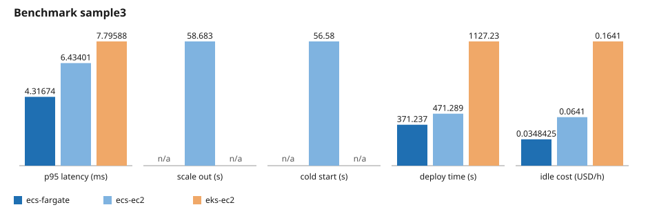

# Agentic Platform Advisor: ECS vs EKS for an AI agent fleet

Should a team host a fleet of AI agents on Amazon ECS or on Amazon EKS, and on Fargate or on EC2?
This repo deploys the same agent workload on each platform, drives the same load at it, and
reports latency, deploy time, configuration size and cost side by side. A LangGraph advisor plans
the run, asks before any spend, deploys, measures, tears everything down and writes the report.

## Verdict

On the published sample run (`sample3`, steady profile, mock workload), **ECS Fargate wins**. It
had the lowest latency at every percentile (p95 4.317 ms, against 6.434 ms on ECS EC2 and
7.796 ms on EKS EC2), the fastest deploy (371 s, against 471 s and 1127 s), the lowest idle cost
(0.0348 USD/h, against 0.0641 and 0.1641) and the lowest cost per thousand requests. No cell
returned an error. Read the limits below before you generalise it.



## Comparison

Copied from [`results/sample/report.md`](results/sample/report.md), which the reporter wrote from
[`results/sample/metrics.json`](results/sample/metrics.json).

| Metric                            | ECS Fargate | EKS EC2 | ECS EC2 |
|-----------------------------------|-------------|---------|---------|
| p50 latency (ms)                  | 3.878       | 5.228   | 5.279   |
| p95 latency (ms)                  | 4.317       | 7.796   | 6.434   |
| p99 latency (ms)                  | 6.815       | 16.118  | 12.580  |
| Error rate                        | 0.000       | 0.000   | 0.000   |
| Deploy time (s)                   | 371.24      | 1127.23 | 471.29  |
| Config lines                      | 436.0       | 534.0   | 436.0   |
| Moving parts                      | 4.0         | 4.0     | 4.0     |
| Idle cost (USD/h)                 | 0.0348425   | 0.1641  | 0.0641  |
| Cost per thousand requests (USD)  | 0.00192     | 0.00270 | 0.00211 |

Scale out and cold start were measured on ECS EC2 only (58.683 s and 56.58 s); the other cells
logged no alarm-to-healthy or scheduled-to-healthy pair, and `metrics.json` lists those as gaps.

## Cost of this run

**About $0.33** for the load window: $0.3252 in all, from the per-cell
[`cost.json`](results/sample/raw) files and [`shared-cost.json`](results/sample/raw/shared-cost.json).

| Item                          | USD    |
|-------------------------------|--------|
| ECS Fargate cell              | 0.0577 |
| ECS EC2 cell                  | 0.0632 |
| EKS EC2 cell                  | 0.0810 |
| Cells, total                  | 0.2019 |
| Shared NAT gateway            | 0.0244 |
| Shared NAT data               | 0.0450 |
| Shared VPC endpoints          | 0.0271 |
| Shared harness vCPU           | 0.0220 |
| Shared harness memory         | 0.0048 |
| Shared, total                 | 0.1233 |
| **Run, total**                | **0.3252** |

This prices only the load window. Real spend, with deploy and teardown time, was about two to
three times this estimate.

## Limits

- **Mock workload.** The agent ran with `LLM_MODE=mock`, so the numbers show platform overhead
  only, not model latency.
- **Steady profile only.** No spike or soak profile was run.
- **Three cells.** ECS Fargate, ECS EC2 and EKS EC2; **eks-fargate was not run**.
- **One run.** A single sample in us-east-1, with no repeats and no error bars.

## How to run

You need an AWS account, an `AWS_PROFILE` (SSO or `aws login`), a region, `uv`, Docker, `helm`
and `kubectl`. The image targets build Intel/AMD Linux images by default, even on an Apple silicon Mac.

```bash
make bootstrap                      # budget alarm, deploy role, OIDC; needs BUDGET_EMAIL
make mirror-base                    # mirror the base images into ECR
make push-image                     # build and push the workload image; export IMAGE_URI
# build and push the load-generator image too (see the Makefile); export K6_IMAGE_URI
make benchmark RUN_ID=<id>          # prints the estimate and asks y/N before any spend
make report RUN_ID=<id>             # rewrite report.md from metrics.json
make chart RUN_ID=<id>              # draw chart.svg from metrics.json
make teardown RUN_ID=<id>           # delete every stack of a run and check nothing is left
```

`make benchmark` always tears its stacks down, even on failure. Run `make teardown` yourself only
when a run was interrupted. Resume a stopped run with `uv run --locked python -m advisor resume <run-id>`.

### Safety rules

From the safety rules section of [`docs/SPEC.md`](docs/SPEC.md):

- All AWS resources are CloudFormation and all Kubernetes objects are Helm. No console step.
- No IAM access keys and no root user.
- The bootstrap stack holds a monthly AWS Budgets alarm.
- Every benchmark stack carries a `ttl-hours` tag, and teardown runs in a `finally` path. A
  scheduled janitor workflow deletes any stack past its TTL.
- All images come from ECR, including the mirrored base images.

## More

- [`docs/SPEC.md`](docs/SPEC.md): the question, matrix, metric definitions and cost model.
- [`docs/architecture.md`](docs/architecture.md): how the advisor and the cells fit together.
