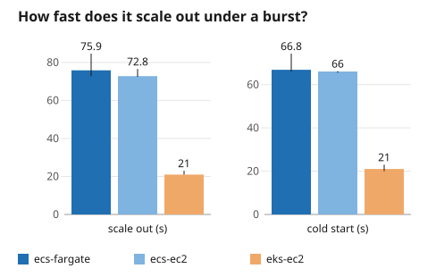
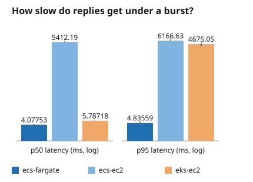
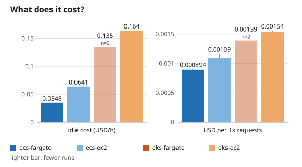
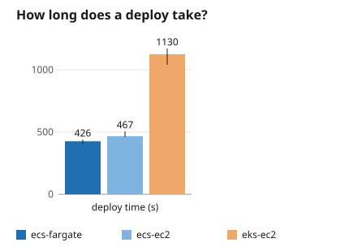
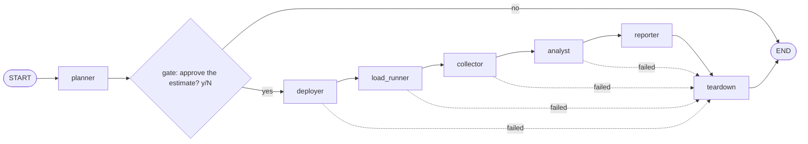
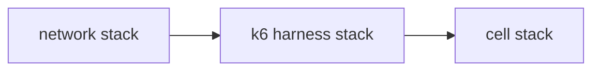

# Agentic Platform Advisor: ECS vs EKS for an AI agent fleet


[](https://github.com/MAOFILHO/agentic-platform-advisor/actions/workflows/ci.yml)

## Project description

Should a team host a fleet of AI agents on **Amazon ECS** or on **Amazon EKS**, and on **Fargate** or on **EC2**? This repo deploys the same agent workload on each platform, drives the same **load test** at it, and reports **latency, deploy time, configuration size and cost** side by side. A **LangGraph advisor** plans the run, **asks before any spend**, deploys with **CloudFormation and Helm**, measures, **always tears everything down** and writes the report.


<br>

## Why this is production-grade

This is a measured comparison with guard rails, not a one-off script. It runs real AWS resources, so it is built to cost little and leave nothing behind:

- **CloudFormation and Helm**: every AWS resource is a CloudFormation stack. The workload and the load balancer controller are Helm releases, and the EKS core add-ons come from CloudFormation. No console step.
- **Approval gate before spend**: the planner prints a cost estimate and the run waits for a y/N answer. A no ends it with nothing deployed.
- **Teardown on every path**: every failure edge of the agent graph ends in teardown, which deletes the run's stacks and reports any leftover resource.
- **TTL tags and a budget alarm**: every benchmark stack carries a `ttl-hours` tag, and the bootstrap stack holds a monthly AWS Budgets alarm.
- **No long-lived credentials**: no IAM access keys and no root user. CI uses a GitHub OIDC role and a laptop uses an SSO profile.
- **Numbers written by code**: the analyst and the tables use no LLM. The LLM writes only the Verdict, and a number and superlative check rejects any claim the data does not support.
- **CI quality gates**: ruff, pytest, `helm lint`, a workload image build, `cfn-lint` and `cfn-guard` run on every pull request.


<br>

## 🔍 The Problem

A team that runs AI agents on AWS has to choose a platform, and the choice is usually made on opinion, not on numbers for an agent workload.

| Current pain point | Impact |
|---|---|
| ECS or EKS is picked from habit or from a blog post | No measured numbers for an agent fleet |
| Fargate or EC2 is a second choice on top of the first | Four combinations, and the trade-offs differ in each |
| Latency, scale-out speed, deploy time and cost sit in different dashboards | Nobody compares them side by side |
| A real benchmark spends real money | A forgotten stack keeps billing |
| A report written by an LLM can state a number that was never measured | The comparison cannot be trusted |

## The Solution

An agent that runs the comparison, spends only after a yes, and cleans up after itself:

- **One workload, four cells**: the same triage agent on ECS Fargate, ECS EC2, EKS Fargate and EKS EC2, each built from its own CloudFormation templates and Helm chart.
- **One load, same profiles**: k6 runs as an ECS task in a fixed harness and drives the `spike` and `scale-from-min` profiles at every cell.
- **Approval before spend**: the planner estimates the cost, and the gate asks y/N.
- **Always torn down**: teardown runs on success and on every failure, and checks that nothing tagged with the run id is left.
- **Honest report**: code turns raw CloudWatch, event and cost files into `metrics.json`, and every number in the report must come from it.


<br>

## 📊 Results and Impact

Five runs in us-east-1, mock workload, on four cells. `short1`, `short2` and `short3` measured ECS
Fargate, ECS EC2 and EKS EC2; `kf5` and `kf6` measured ECS Fargate and EKS Fargate. So ECS EC2 and
EKS EC2 rest on 3 runs, EKS Fargate on 2 and ECS Fargate on 5. Each figure is the median, with the
min to max of its runs in brackets. One finding per question:

→ **Scale out under a burst: EKS EC2 is fastest.** In the `spike` profile EKS EC2 went from alarm
to a healthy new replica in 21 s (21 to 23), against 72.8 s (72.5 to 76.5) on ECS EC2 and
72.8 s (42.9 to 84.7) on ECS Fargate. EKS Fargate scaled out in 61 s with a cold start of
24.3 s, both from `kf5` alone (n=1): `kf6` logged neither, so draw no conclusion from them.
In `scale-from-min` only ECS EC2 scaled out, in 186 s (148 to 233).
[Chart](results/published/chart-burst-scaling.svg).

→ **Latency under a burst: both Fargate cells stayed fast.** In `spike` ECS Fargate held p50
3.87 ms (3.67 to 4.33) and p95 4.83 ms (4.47 to 5.63), and EKS Fargate held p50 3.66 ms
(3.18 to 4.14) and p95 4.75 ms (4.39 to 5.12). The ranges overlap, so neither Fargate cell is
faster. ECS EC2 had a p50 of 5412 ms (5406 to 6210), so most of its requests waited.
EKS EC2 kept p50 at 5.79 ms but its p95 was 4675 ms (3862 to 5311): most requests were fast and
a tail waited. One EKS EC2 run returned errors on 1.57% of requests. The cause is not proven: the runs
did not record why requests waited on the EC2 cells.
[Chart](results/published/chart-burst-latency.svg).

→ **Cost: ECS Fargate is cheapest.** Idle cost was 0.0348 USD/h on ECS Fargate, 0.0641 on ECS EC2,
0.1348 on EKS Fargate and 0.1641 on EKS EC2. Per thousand requests: 0.0009, 0.0011, 0.0014 and
0.0015 USD. [Chart](results/published/chart-cost.svg).

→ **Deploy: the EKS cells are slowest.** ECS Fargate deployed in 402 s (389 to 439), ECS EC2 in
467 s (460 to 505), EKS EC2 in 1125 s (1041 to 1171) and EKS Fargate in 1316 s (1294 to 1338).
[Chart](results/published/chart-deploy.svg).

### Fargate against Fargate

What changes when EKS runs on Fargate instead of EC2:

- **Scale out and cold start:** EKS Fargate scaled out in 61 s and started cold in 24.3 s, from one
  run (n=1). EKS EC2 scaled out in 21 s (21 to 23). One run is not enough to rank them.
- **Latency:** in `spike` the EKS Fargate p95 was 4.75 ms (4.39 to 5.12), against 4675 ms
  (3862 to 5311) on EKS EC2. The slow tail seen on EKS EC2 did not show on EKS Fargate.
- **Idle cost:** 0.1348 USD/h on EKS Fargate, against 0.1641 on EKS EC2.
- **Deploy time:** 1316 s (1294 to 1338) on EKS Fargate, against 1125 s (1041 to 1171) on EKS EC2.
- **Moving parts:** 8 on EKS Fargate and 8 on EKS EC2. The node group and the controller's pod
  identity give way to a Fargate profile and an OIDC provider.

And EKS Fargate against ECS Fargate:

- **Latency overlaps.** Their `spike` p50 ranges are 3.18 to 4.14 ms on EKS Fargate and 3.67 to
  4.33 ms on ECS Fargate.
- **No winner on scale out.** ECS Fargate scaled out in 42.9 to 84.7 s and its cold start took
  36.6 to 74.3 s. The low ends come from `kf5` and `kf6`, the high ends from the `short` runs; the cause
  of that gap is not proven. The one EKS Fargate scale-out figure, 61 s, sits inside that range.
- **Idle cost and deploy time are stable and favour ECS Fargate:** 0.0348 USD/h idle against
  0.1348 on EKS Fargate, and a deploy of 402 s (389 to 439) against 1316 s (1294 to 1338).
- **Cross-check:** `kf4`, one run of the `spike` profile alone, is not in the aggregate (other
  profile set). For EKS Fargate it gave a scale out of 53 s and a cold start of 17.3 s, against
  61 s and 24.3 s in `kf5`. So the EKS Fargate `spike` scale out lies between 53 and 61 s, from
  2 observations, not a measured spread. Its ECS Fargate pair was close to those of the `short` runs.

Read the limits below before you generalise it.









### Which one should I pick?

- **Replies must stay fast through a burst:** ECS Fargate or EKS Fargate. In `spike` the ECS
  Fargate p95 was 4.83 ms and the EKS Fargate p95 4.75 ms, with overlapping ranges, against
  6167 ms on ECS EC2 and 4675 ms on EKS EC2.
- **New capacity must arrive fast:** EKS EC2. It scaled out in 21 s, but in the same burst its p95
  reached 4675 ms, so test the tail before you rely on it.
- **The idle bill matters most:** ECS Fargate, at 0.0348 USD/h idle, against 0.1348 on EKS Fargate
  and 0.1641 on EKS EC2.
- **You need Kubernetes and no nodes to run:** EKS Fargate. Its burst latency matched ECS Fargate,
  but it rests on 2 runs, its scale-out figure on 1, and it took longest to deploy.

### Comparison

Written by `python -m scripts.make_readme_tables` from
[`results/published/aggregate.json`](results/published/aggregate.json), which
`scripts/aggregate_runs.py` built from the five runs' `metrics.json`
([`short1`](results/published/short1-metrics.json), [`short2`](results/published/short2-metrics.json),
[`short3`](results/published/short3-metrics.json), [`kf5`](results/published/kf5-metrics.json),
[`kf6`](results/published/kf6-metrics.json)). Each cell is `median (min to max)`, or one value when
all runs agreed. The Runs row gives n, how many runs each column rests on; a figure that rests on
fewer runs shows its own n.

<!-- tables: python -m scripts.make_readme_tables -->
**Profile `spike`**

| Metric | ecs-fargate | ecs-ec2 | eks-fargate | eks-ec2 |
|---|---|---|---|---|
| Runs | n=5 | n=3 | n=2 | n=3 |
| p50 latency (ms) | 3.87 (3.67 to 4.33) | 5412 (5406 to 6210) | 3.66 (3.18 to 4.14) | 5.79 (5.74 to 5.88) |
| p95 latency (ms) | 4.83 (4.47 to 5.63) | 6167 (6077 to 7586) | 4.75 (4.39 to 5.12) | 4675 (3862 to 5311) |
| p99 latency (ms) | 10.4 (8.82 to 16.1) | 7174 (7168 to 8252) | 9.01 (6.92 to 11.1) | 6051 (6020 to 6056) |
| Error rate | 0.00% | 0.00% | 0.00% | 0.00% (0.00% to 1.57%) |
| Scale out (s) | 72.8 (42.9 to 84.7) | 72.8 (72.5 to 76.5) | 61 (n=1) | 21 (21 to 23) |
| Cold start (s) | 66.0 (36.6 to 74.3) | 66.0 (65.5 to 66.2) | 24.3 (n=1) | 21 (20 to 23) |

**Profile `scale-from-min`**

| Metric | ecs-fargate | ecs-ec2 | eks-fargate | eks-ec2 |
|---|---|---|---|---|
| Runs | n=5 | n=3 | n=2 | n=3 |
| p50 latency (ms) | 4.39 (4.09 to 5.22) | 5.48 (5.03 to 5.77) | 3.64 (2.99 to 4.28) | 5.35 (5.33 to 5.75) |
| p95 latency (ms) | 5.93 (4.83 to 6.55) | 6.55 (5.95 to 11.1) | 4.34 (3.36 to 5.32) | 8.28 (8.23 to 9.09) |
| p99 latency (ms) | 11.8 (9.30 to 45.3) | 11.0 (9.98 to 26.7) | 7.35 (6.53 to 8.16) | 15.6 (13.0 to 16.1) |
| Error rate | 0.00% | 0.00% | 0.00% | 0.00% |
| Scale out (s) | n/a | 186 (148 to 233) | n/a | n/a |
| Cold start (s) | n/a | 183 (144 to 222) | n/a | n/a |

**Per cell**

| Metric | ecs-fargate | ecs-ec2 | eks-fargate | eks-ec2 |
|---|---|---|---|---|
| Runs | n=5 | n=3 | n=2 | n=3 |
| Deploy time (s) | 402 (389 to 439) | 467 (460 to 505) | 1316 (1294 to 1338) | 1125 (1041 to 1171) |
| Config lines | 436 | 436 | 577 | 534 |
| Moving parts | 2 | 5 | 8 | 8 |
| Idle cost (USD/h) | 0.0348 | 0.0641 | 0.1348 | 0.1641 |
| USD per thousand requests | 0.0009 | 0.0011 (0.0011 to 0.0012) | 0.0014 | 0.0015 (0.0015 to 0.0016) |

Moving parts by cell, counted from its templates:

- ecs-fargate: LoadBalancer, ScalableTarget
- ecs-ec2: LoadBalancer, LaunchTemplate, AutoScalingGroup, CapacityProvider, ScalableTarget
- eks-fargate: vpc-cni, kube-proxy, coredns, metrics-server, eks-pod-identity-agent, FargateProfile, LbcOidcProvider, aws-load-balancer-controller
- eks-ec2: vpc-cni, kube-proxy, coredns, metrics-server, eks-pod-identity-agent, NodeGroup, LbcPodIdentity, aws-load-balancer-controller

Limits: cells were measured in different run sets; ecs-fargate appears in all of them.
<!-- /tables -->

## Limits

- **3 runs, 2 for eks-fargate.** ECS EC2 and EKS EC2 rest on 3 runs, EKS Fargate on 2 and ECS
  Fargate on 5, all in us-east-1. The brackets show their spread; there are no error bars. The
  EKS Fargate `spike` scale out and cold start rest on 1 run.
- **Different run sets.** The cells were not all measured in the same runs: EKS Fargate ran only
  in `kf5` and `kf6`, and ECS EC2 and EKS EC2 only in the `short` runs.
- **Two profiles.** Only `spike` and `scale-from-min` were run; no steady, step or soak profile.
- **Mock workload.** The agent ran with `LLM_MODE=mock`, so the numbers show platform overhead
  only, not model latency. No run with a real model has been done.
- **Add-on versions.** The EKS add-ons ran the versions AWS picked by default on 19 Oct 2026, the
  day of `kf5` and `kf6`.
- **Fargate sizing.** Fargate rounds each task or pod up to the next CPU and memory step AWS
  offers, so a cell may get more than it asked for.
- **Two gaps.** In `scale-from-min`, ECS Fargate and EKS EC2 logged no scale-out in their load
  window: the load stayed under their CPU scaling target, so they have no scale-out or cold-start
  figure there. EKS Fargate logged none there either.


<br>

## 🏗️ Architecture

The advisor is a LangGraph graph (`advisor/graph.py`). Nothing is spent before the gate's yes,
and every path after it ends in teardown.



1. `planner`: builds the run matrix and estimates the cost before any spend.
1. `gate`: pauses for a y/N answer; a no ends the run.
1. `deployer`: deploys each cell's stacks; a failed command stops it.
1. `load_runner`: runs k6 as an ECS task in the harness, per profile.
1. `collector`: reads CloudWatch, events and costs into raw files; changes nothing.
1. `analyst`: turns the raw files into `metrics.json` with code, no LLM.
1. `reporter`: writes `report.md` tables; the LLM writes only the Verdict.
1. `teardown`: deletes every stack of the run and reports any leftovers.

The deployer creates three stacks per cell, in this order. Teardown deletes them newest first.



The deploy flow, the agent graph and the benchmark data flow are also drawn in [`docs/architecture.md`](docs/architecture.md).

## 🛠️ Tech stack

| Area | Tools | Used for |
|---|---|---|
| Agent and orchestration | Python, LangGraph, langgraph-checkpoint-sqlite, uv | The advisor that plans, deploys, measures and tears down, with a SQLite checkpoint to resume a run |
| Cloud compute | Amazon ECS, Amazon EKS, AWS Fargate, Amazon EC2, Application Load Balancer | The four cells under test |
| Infrastructure as code | AWS CloudFormation, boto3, awscrt | VPC with NAT and endpoints, clusters, IAM (IRSA and Pod Identity), ECR, CloudWatch with Container Insights, AWS Budgets |
| Kubernetes packaging | Helm, kubectl | The workload chart and the load balancer controller on the EKS cells |
| Load testing | k6 | The `steady`, `step`, `spike` and `scale-from-min` profiles |
| Workload | FastAPI, uvicorn, pydantic, Docker | The mock triage agent image |
| Reporting and charts | Amazon Bedrock (Nova Micro), pydantic, SVG charts from `scripts/` | The Verdict, the tables and the charts |
| Testing and quality | pytest, httpx, ruff, cfn-lint, cfn-guard | Unit tests, README number checks, lint and template checks |
| CI | GitHub Actions | Lint, tests, `helm lint`, image build and template checks on every pull request |

## ☁️ AWS services used

Each service below is created by a template in `infra/cfn/` or called by the advisor's code.

| Service | Purpose |
|---|---|
| Amazon ECS | The two ECS cells, and the cluster that runs the load generator |
| Amazon EKS | The `eks-fargate` and `eks-ec2` cells, with the vpc-cni, kube-proxy, coredns, metrics-server and eks-pod-identity-agent add-ons |
| AWS Fargate | Serverless compute for the Fargate cells: ECS tasks and an EKS Fargate profile |
| Amazon EC2 and Auto Scaling | A launch template, an Auto Scaling group and a capacity provider for ECS EC2, and a managed node group for EKS EC2 |
| Application Load Balancer | The entry point of every cell, which k6 drives |
| Application Auto Scaling | The scalable target and CPU scaling policy of the ECS services |
| Amazon VPC | Subnets, an internet gateway, a NAT gateway with an Elastic IP, and interface endpoints for ECR, CloudWatch Logs and STS plus a gateway endpoint for S3 |
| Amazon CloudWatch | Log groups, and Container Insights metrics that the collector reads |
| Amazon ECR | Private repositories for the workload image and the mirrored base images |
| AWS IAM | Roles and an instance profile, the GitHub OIDC role, IRSA (an OIDC provider) on EKS Fargate and Pod Identity on EKS EC2 |
| AWS CloudFormation | Every AWS resource, deployed through change sets and deleted by teardown |
| Amazon Bedrock | Nova Micro writes the Verdict of the report; the workload can also call it with `LLM_MODE=bedrock` |
| AWS Budgets | A monthly budget alarm in the bootstrap stack |
| AWS Systems Manager | Public parameters that give the latest EKS Kubernetes version and AMI at deploy time |
| AWS Price List and Resource Groups Tagging | The cost model reads prices, and teardown looks for resources still tagged with the run id |


<br>

## Prerequisites

- An AWS account and an `AWS_PROFILE` (SSO or `aws login`), with a region set in `AWS_REGION`
- The AWS CLI, [`uv`](https://docs.astral.sh/uv/), Docker, `helm` and `kubectl`
- Python is pinned in `.python-version`; `uv` installs it

The image targets build Intel/AMD Linux images by default, even on an Apple silicon Mac.

## Setup

```bash
git clone https://github.com/MAOFILHO/agentic-platform-advisor.git
cd agentic-platform-advisor
uv sync --locked

export AWS_PROFILE=<your-profile>
export AWS_REGION=us-east-1
```

## 🚀 Running the project

```bash
make bootstrap                      # budget alarm, deploy role, OIDC; needs BUDGET_EMAIL
make mirror-base                    # mirror the base images into ECR
make push-image                     # build and push the workload image; export IMAGE_URI
# build and push the load-generator image too (see the Makefile); export K6_IMAGE_URI
make benchmark RUN_ID=<id>          # prints the estimate and asks y/N before any spend
make report RUN_ID=<id>             # rewrite report.md from metrics.json
make chart RUN_ID=<id>              # draw chart.svg from metrics.json
make aggregate RUNS=a,b,c OUT=<name>  # median and min to max over several runs, no AWS call
```

`make benchmark` always tears its stacks down, even on failure. Resume a stopped run with
`uv run --locked python -m advisor resume <run-id>`.

## Cleanup and verify

```bash
make teardown RUN_ID=<id>           # delete every stack of a run, newest first, then check nothing is left
```

Run `make teardown` yourself only when a run was interrupted. It asks y/N first, and then it lists
any resource still tagged with the run id.

### Safety rules

From the safety rules section of [`docs/SPEC.md`](docs/SPEC.md):

- Every AWS resource is a CloudFormation stack. The workload and the load balancer controller are Helm releases, and the EKS core add-ons come from CloudFormation. No console step.
- No IAM access keys and no root user.
- The bootstrap stack holds a monthly AWS Budgets alarm.
- Every benchmark stack carries a `ttl-hours` tag, and teardown runs in a `finally` path.
- All images come from ECR, including the mirrored base images.

## Project structure

```
.github/workflows/   CI: lint, tests, helm lint, image build, cfn-lint and cfn-guard
advisor/             the LangGraph advisor: planner, gate, deployer, load runner, collector, analyst, reporter, teardown
docs/                SPEC, METHOD, architecture and decision records (adr/)
infra/cfn/           CloudFormation templates: bootstrap, network, harness, ECS, EKS and the controller role
infra/cfn-guard/     cfn-guard rules for the templates
infra/helm/workload/ Helm chart for the EKS cells
loadtests/           k6 profiles and the load-generator image
results/             published aggregate, charts and the sample run
runs/                default capacity and plan settings for a run
scripts/             deploy, teardown, image, chart, aggregate and README table tools
tests/               pytest suite and cfn-guard fixtures
workload/            the mock triage agent (FastAPI) and its Dockerfile
```

## 🧪 Running tests

```bash
uv run --locked pytest      # unit tests and README number checks, no AWS credentials needed
uv run --locked ruff check
```

## AWS region

All runs were measured in us-east-1.

## Cost estimate

This is the single `sample3` run (steady profile), the only run with its cost files published.
**About $0.33** for the load window: $0.3252 in all, from the per-cell
[`cost.json`](results/sample/raw) files and [`shared-cost.json`](results/sample/raw/shared-cost.json).

| Item                          | USD    |
|-------------------------------|--------|
| ECS Fargate cell              | 0.0577 |
| ECS EC2 cell                  | 0.0632 |
| EKS EC2 cell                  | 0.0810 |
| Cells, total                  | 0.2019 |
| Shared NAT gateway            | 0.0244 |
| Shared NAT data               | 0.0450 |
| Shared VPC endpoints          | 0.0271 |
| Shared harness vCPU           | 0.0220 |
| Shared harness memory         | 0.0048 |
| Shared, total                 | 0.1233 |
| **Run, total**                | **0.3252** |

This prices only the load window. Real spend, with deploy and teardown time, was about two to
three times this estimate. A Fargate run of 2 cells and 2 profiles (`kf5`, `kf6`) cost
USD 1.2 to 1.8 in real AWS spend.

## Key engineering decisions

| Challenge | Solution |
|---|---|
| Pod Identity does not run on Fargate | The load balancer controller role trusts the cluster OIDC provider (IRSA) on `eks-fargate`, and uses Pod Identity on `eks-ec2` |
| CoreDNS and metrics-server pods created before the Fargate profile stay Pending | The profile is a dependency of both add-ons, and the deploy restarts them if a pod is Pending and waits until both are Ready |
| The cost estimate prices only the load window | The estimate says so, and the README states that real spend was about two to three times higher |
| An LLM can state a number that was never measured | The LLM writes only the Verdict; code writes the tables, and a number and ranking check rejects false claims |
| A failed stage could leave stacks billing | Every failure edge of the graph goes to teardown, which checks that nothing tagged with the run id is left |
| Diagnostics could leak an account id | Command output and raw files are masked, and a test scans every tracked file |
| `aws login` profiles need the AWS common runtime | `awscrt` is a dependency, and a test covers it |
| Model latency would hide platform differences | The default workload runs with `LLM_MODE=mock` (ADR 0003), so the numbers show platform overhead only |

## More

- [`docs/METHOD.md`](docs/METHOD.md): how the comparison was run, so you can judge whether it is fair.
- [`docs/SPEC.md`](docs/SPEC.md): the question, matrix, metric definitions and cost model.
- [`docs/architecture.md`](docs/architecture.md): how the advisor and the cells fit together.

## License

MIT. See [LICENSE](LICENSE).

## Author

**Marcos Oliveira** — [LinkedIn](https://www.linkedin.com/in/mfilho1/) | [GitHub](https://github.com/MAOFILHO)
