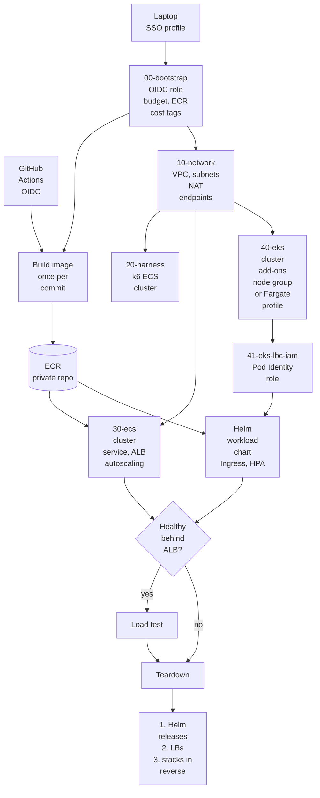
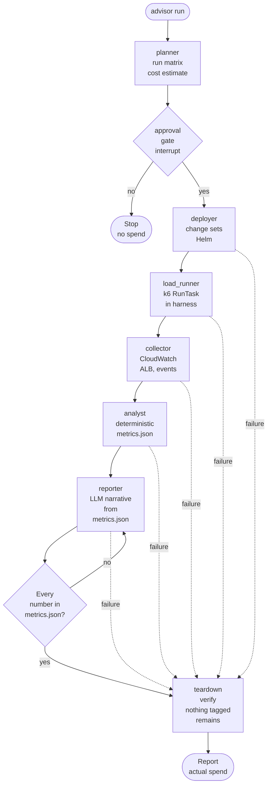
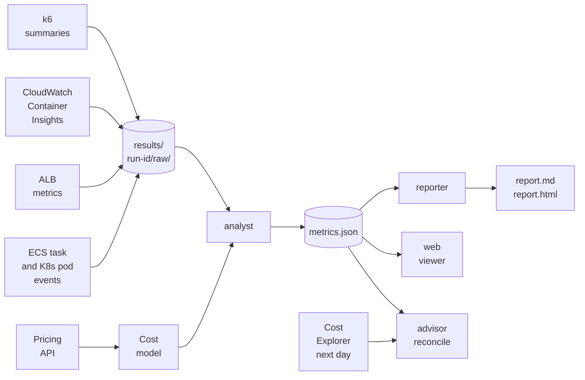

# Architecture

Three views of the system. Decisions behind them are in `docs/adr/`. Scope and metrics are in `docs/SPEC.md`.

## 1. Deploy flow

Stacks are created in layer order and deleted in reverse. EKS cells add a Helm release on top of their stack.

## 2. Agent graph

The advisor is a LangGraph graph with a Pydantic state and a SQLite checkpointer. Teardown runs on every path, including failures.

## 3. Benchmark data flow

Raw data is written once. Every figure in the report traces back to a raw file.

